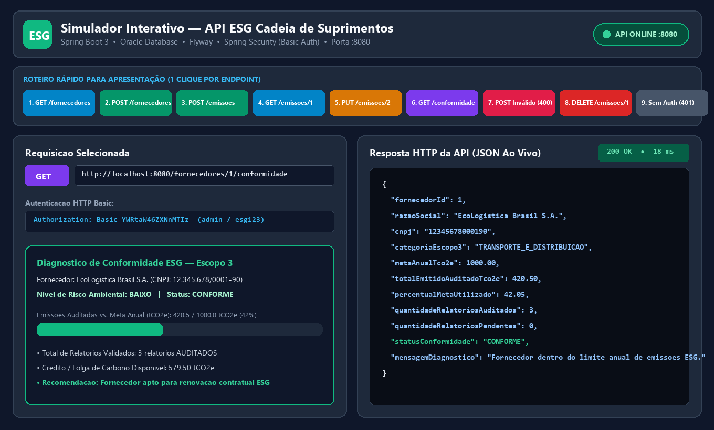

# Simulador Interativo — API ESG Cadeia de Suprimentos

**Autor:** Renan Santa Rosa Xavier — RM566997

---

## Sobre o Projeto

Painel visual interativo desenvolvido para testar, inspecionar e demonstrar em tempo real todas as funcionalidades da **[API RESTful ESG (Spring Boot)](https://github.com/Renan-Xavier/ESG-Spring-API)**.

---

## Roteiro Rápido de Demonstração (Botões 1 a 9)

Na barra superior do simulador, os botões numerados de **1 a 9** executam ao vivo todo o fluxo de avaliação da API:

1. **`GET /fornecedores`** — Lista os fornecedores cadastrados automaticamente pelo Flyway.
2. **`POST /fornecedores`** — Cadastra um novo fornecedor na cadeia de suprimentos.
3. **`POST /emissoes`** — Registra um novo relatório de emissão de carbono de Escopo 3.
4. **`GET /emissoes/1`** — Consulta os detalhes de um relatório específico.
5. **`PUT /emissoes/2`** — Aprova a auditoria alterando o status de `PENDENTE` para `AUDITADO`.
6. **`GET /fornecedores/1/conformidade`** — Calcula o diagnóstico consolidado de conformidade ESG do fornecedor.
7. **`POST /fornecedores` (Dados Inválidos — `400 Bad Request`)** — Demonstra o Bean Validation e o `TratadorGlobalExcecoes` bloqueando payloads inválidos.
8. **`DELETE /emissoes/1`** — Demonstra a exclusão/invalidação de um relatório de emissão.
9. **Teste Sem Autenticação (`401 Unauthorized`)** — Demonstra o bloqueio de segurança do `Spring Security` quando as credenciais não são enviadas.

---

## Como Executar

1. Dê dois cliques no script [`INICIAR_SIMULADOR.bat`](INICIAR_SIMULADOR.bat) para abrir o painel no navegador e iniciar a API Spring Boot automaticamente na porta `8080`, ou abra diretamente o arquivo [`index.html`](index.html) no navegador.
2. Certifique-se de que a [API ESG Spring Boot](https://github.com/Renan-Xavier/ESG-Spring-API) esteja rodando em `http://localhost:8080`.
